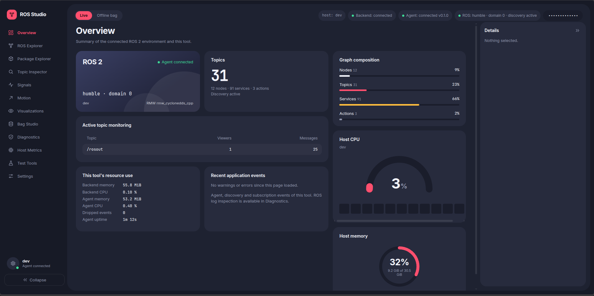
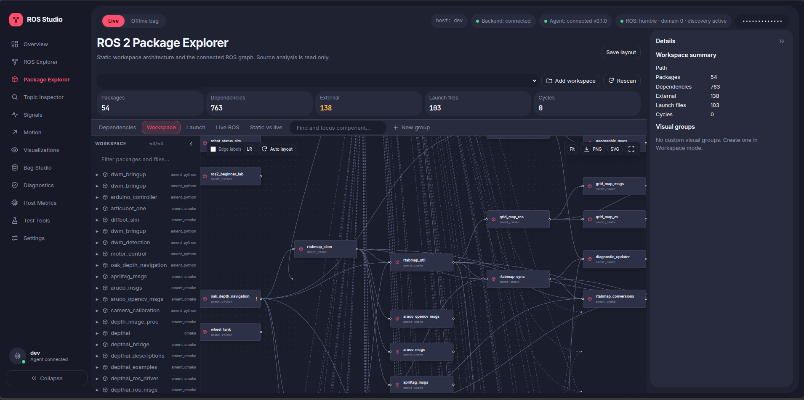
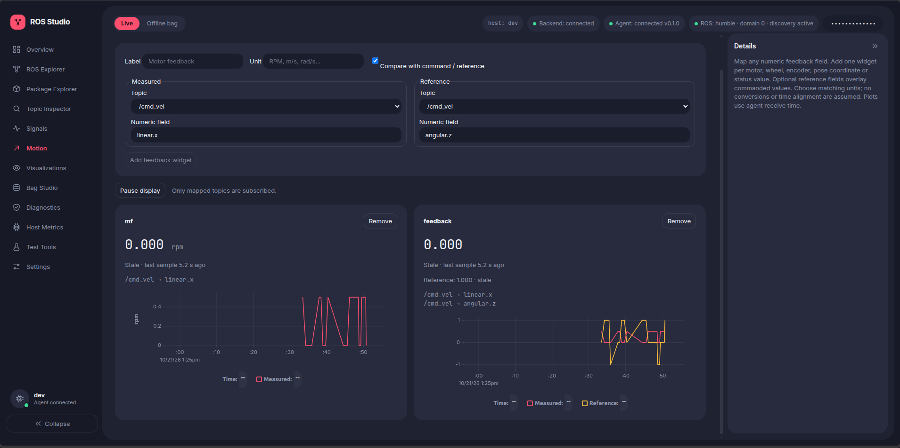
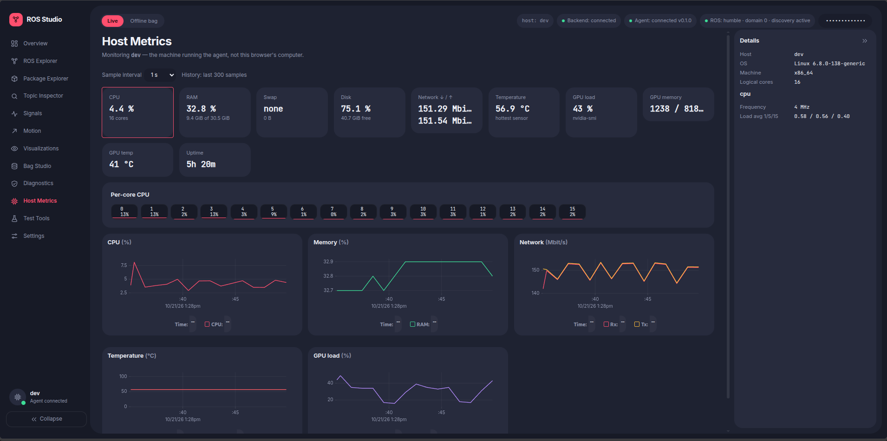
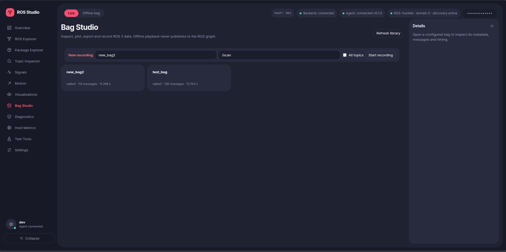

# ROS Developer Studio

Created by **Nazmul Rahman Arnab**.

ROS Developer Studio is a local workspace for inspecting a ROS 2 system, investigating telemetry, and analyzing recorded bags. It brings graph discovery, opt-in topic monitoring, visualizations, host metrics, and evidence-based diagnostics into one browser UI.

The project is designed to be **read-only by default** and works independently of a robot-specific package. It is an engineering and debugging tool, not a robot control, navigation, or fleet-management system.

## Project status

Core live inspection, visualization, Bag Studio, and Phase 5 diagnostics are implemented. Phase 5 runtime and browser verification is still pending. Bag reading has been checked against a real ROS 2 Humble SQLite3 recording; MCAP support depends on the ROS storage plugin installed on the host.

Test Tools, installer work, hardware acceptance, and final release checks are not complete. Test Tools are not currently available. The project targets ROS 2 Humble and Jazzy, but Jazzy and Raspberry Pi/Jetson performance have not been verified. See [Progress](PROGRESS.md), the [feature matrix](docs/FEATURE_MATRIX.md), and [test notes](docs/TESTING.md) for detail.

## Features

- Discover ROS 2 nodes, topics, services, actions, publishers, subscribers, and endpoint QoS.
- Inspect topics on demand, with message fields, rate, timing, and bandwidth information.
- Build numeric Signals and Motion views from discovered topics and user-selected field paths.
- Visualize camera, LaserScan, IMU, battery, odometry, Twist, and TF data.
- Review host metrics and inspect ROS packages and workspace files.
- Read ROS 2 bags directly in Bag Studio: browse metadata, seek and sample playback, inspect messages, plot numeric fields, analyze timing, and export CSV.
- Investigate diagnostic findings, review captured ROS logs, define numeric expectations, correlate nearby evidence, and export a JSON report.

Subscriptions are opt-in: the app does not subscribe to every topic automatically. Bag playback reads recordings directly and does not publish messages into the live ROS graph.

## Screenshots

| Overview | Package Explorer |
|---|---|
|  |  |

| Motion | Host Metrics |
|---|---|
|  |  |

| Bag Studio |
|---|
|  |

## Architecture

The browser UI is built with React, TypeScript, and Vite. A FastAPI backend serves the UI and coordinates data. For live ROS inspection, a separate Python agent uses `rclpy` on the ROS host. Offline bag analysis does not require a running ROS graph or agent, though ROS message packages and storage plugins may be needed to decode some recordings.

By default, the backend and agent communicate over loopback. See [Architecture](docs/ARCHITECTURE.md) for details.

## Requirements

- Linux with ROS 2 Humble or Jazzy installed for live ROS inspection. Bag-only workflows can run without a live ROS graph.
- Python 3.10 or newer.
- Node.js 18 or newer for building the frontend.
- A sourced ROS 2 environment and the relevant message packages to decode custom message types or run the agent.

ROS 2 Python packages such as `rclpy` and `rosbag2_py` come from the ROS installation; they are not installed by `pip`.

## Install

Clone the repository and run the setup from its root on the ROS 2 host:

```bash
git clone https://github.com/nazmulrahman/ros-developer-studio.git
cd ros-developer-studio
source /opt/ros/humble/setup.bash  # use jazzy/setup.bash for Jazzy
python3 -m venv --system-site-packages .venv
source .venv/bin/activate
python -m pip install -r requirements.txt

cd frontend
npm ci
npm run build
cd ..
```

The virtual environment uses `--system-site-packages` so it can access ROS Python packages installed with the ROS distribution. If you use custom message packages, source your workspace as well. The agent launcher can do this with `WORKSPACE=/path/to/ros2_ws`.

Optionally copy `config/studio.example.toml` to `config/studio.toml` and edit bag and workspace directories for your machine. See [Bag Studio setup](docs/BAG_STUDIO.md) and [Package Explorer](docs/PACKAGE_EXPLORER.md).

## Run

Start the ROS agent in one terminal:

```bash
source .venv/bin/activate
scripts/run_agent.sh
```

Start the backend in another terminal:

```bash
source .venv/bin/activate
python -m backend.main
```

Open the URL printed by the backend and enter its one-time access token in the top bar. By default, the backend listens on `127.0.0.1:8800` and the agent listens on loopback at port `8770`.
The FastAPI reference is available at `http://127.0.0.1:8800/docs` while the backend is running.

To explore the UI without ROS hardware, the agent has a no-ROS mode that still provides host metrics:

```bash
source .venv/bin/activate
python -m agent.main --no-ros
```

Then start the backend in a second terminal as above.

For frontend development, run `npm run dev` from `frontend/`. The development server is configured to proxy API requests to the local backend.

## Configuration and network access

The example configuration is [config/studio.example.toml](config/studio.example.toml). The backend generates a new token at startup unless a token is provided explicitly. Bag directories and recording destinations can be restricted in the configuration; workspace roots control which folders Package Explorer can inspect.

The backend has no built-in TLS. Keep it bound to loopback for local use. If you deliberately expose it on a network, use a trusted private network or a secure tunnel, keep token authentication enabled, and do not expose it directly to the public internet. The agent is intended to remain on loopback.

Test Tools are not implemented yet. They are planned as a separately gated Phase 6 feature; do not use this application to issue robot commands.

## Checks

Run the automated Python suite:

```bash
python -m pip install 'pytest>=8' 'httpx>=0.27'
python -m pytest
```

Run frontend checks and create the production build:

```bash
cd frontend
npm ci
npm test
npm run build
```

For the isolated ROS 2 Humble integration fixture, source ROS and run:

```bash
.venv/bin/python -m scripts.verify_phase3_ros
```

This uses synthetic publishers in an isolated ROS domain; it is not a hardware acceptance test. Phase 5 runtime regression and browser acceptance have not yet been completed. See [Testing](docs/TESTING.md) for coverage and limitations.

## Current limitations

- Phase 5 findings, log capture, profiles, and correlation are implemented but still need runtime regression and browser verification. Live log and diagnostic buffers are bounded process memory, not an archive.
- Live bag recording has API/status coverage but has not been verified with live robot topics. MCAP reading requires the matching ROS storage plugin; recordings with unavailable message definitions may only expose metadata or raw-message details.
- TF is a bounded model of observed transforms, not a historical TF2 lookup buffer. Sampling can miss short-lived changes.
- Offline playback samples recorded messages around the selected timeline position; it is not a lossless replay stream.
- Jazzy, robot hardware, Raspberry Pi, and Jetson acceptance remain outstanding.
- Write operations such as publishing, calling services, setting parameters, and velocity tests are not available in this release.

## Documentation

- [Architecture](docs/ARCHITECTURE.md)
- [Feature matrix](docs/FEATURE_MATRIX.md)
- [Diagnostic strategy](docs/DIAGNOSTIC_STRATEGY.md)
- [Bag Studio](docs/BAG_STUDIO.md)
- [Package Explorer](docs/PACKAGE_EXPLORER.md)
- [API reference](docs/API.md)
- [Testing notes](docs/TESTING.md)
- [Project progress](PROGRESS.md)

## License

This project is licensed under the MIT License. See [LICENSE](LICENSE).
